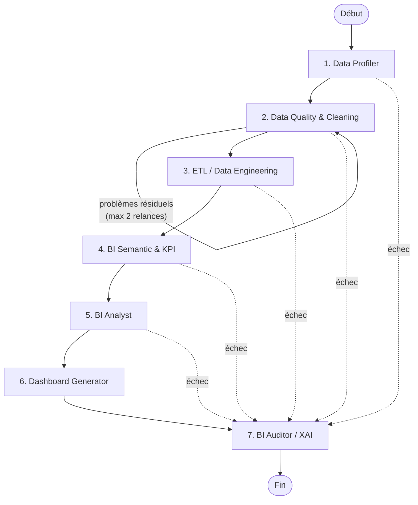

# Bi-flow — Automatisation du pipeline BI par une architecture multi-agents

> **Du jeu de données brut à un dashboard intelligent, explicable et automatisé.**

Bi-flow est un système multi-agents qui automatise un pipeline de Business Intelligence complet :
il part de données hétérogènes (CSV, Excel, bases SQL, API) et produit des KPI, des insights,
un dashboard interactif et un rapport d'explicabilité (XAI).

Cette branche **`Orchestrator`** contient l'**agent orchestrateur** : le chef d'orchestre qui
coordonne les 7 agents du pipeline, décide de l'ordre d'exécution, gère les relances et les
échecs, et garde une trace explicable de chaque décision.

---

## 1. Contexte et objectif

Le système doit permettre de :

- analyser automatiquement des données hétérogènes ;
- nettoyer et transformer les données ;
- calculer les KPI pertinents ;
- générer des visualisations et des insights ;
- expliquer les résultats de manière transparente (XAI).

Il est conçu pour être appliqué à plusieurs secteurs : **e-commerce / retail, banque / finance,
télécommunications, transport / tourisme, santé, énergie / utilities**. L'équipe peut commencer
par un seul métier puis étendre le projet.

---

## 2. Les agents du système

| # | Agent | Nœud | Rôle | Écrit dans l'état |
|---|-------|------|------|-------------------|
| 0 | **Orchestrator Agent** | — | Coordonne le pipeline et fait le lien entre les agents | `control`, `trace` |
| 1 | **Data Profiler Agent** | `profiler` | Analyse la structure des données et détecte les problèmes (types, doublons, valeurs manquantes…) | `profile_report` |
| 2 | **Data Quality & Cleaning Agent** | `quality` | Nettoie et corrige les données (erreurs, incohérences, formats…) | `clean_data`, `quality_report` |
| 3 | **ETL / Data Engineering Agent** | `etl` | Transforme et organise les données (jointures, agrégations, modèle de données) | `data_model` |
| 4 | **BI Semantic & KPI Agent** | `semantic` | Identifie les KPI, crée les calculs et les définitions métier | `kpi_catalog` |
| 5 | **BI Analyst Agent** | `analyst` | Analyse les données, détecte les tendances et génère des insights | `insights` |
| 6 | **Dashboard Generator Agent** | `dashboard` | Crée automatiquement le dashboard interactif avec les bonnes visualisations | `dashboard` |
| 7 | **BI Auditor / XAI Agent** | `xai` | Vérifie la qualité, explique les résultats et génère un rapport de traçabilité | `xai_report` |

---

## 3. Fonctionnement global

```
Données brutes → Profilage → Nettoyage → Transformation (ETL) → Calcul des KPI
              → Analyse des résultats → Dashboard → Explication (XAI)
```

---

## 4. L'agent orchestrateur

L'orchestrateur **ne traite aucune donnée**. Il décide :

- **qui** s'exécute ;
- **dans quel ordre** ;
- **quoi faire** en cas de problème (relancer un agent ou arrêter le pipeline).

Il est construit avec **[LangGraph](https://github.com/langchain-ai/langgraph)** : chaque agent est un
**nœud** du graphe, c'est-à-dire une simple fonction `(state) -> dict`. Les agents ne se parlent
jamais directement : ils lisent et écrivent dans un **état partagé** (`BIFlowState`), et les
**arêtes** du graphe disent qui passe après qui.

### Le graphe



### Règles de décision

| Situation | Décision de l'orchestrateur |
|-----------|-----------------------------|
| Chemin nominal | `profiler → quality → etl → semantic → analyst → dashboard → xai` |
| `quality_report.has_residual_issues = True` | **Relance** de l'agent qualité, au plus **2 fois** (3 passages maximum, jamais de boucle infinie) |
| Plafond de relances atteint | Poursuite vers `etl`, décision tracée avec une confiance de 0,5 |
| Un agent lève une exception | **Arrêt** du pipeline et **saut direct vers `xai`**, qui explique l'échec |
| Un agent écrit un champ réservé ou inconnu | Champ **ignoré** et avertissement journalisé |
| Un agent manque à la construction | Le graphe **refuse de se construire** (`ValueError`) |

L'agent **XAI s'exécute toujours**, même après un échec, pour que chaque exécution soit expliquée.

### L'enveloppe `_wrap()`

Chaque agent d'un coéquipier reste une fonction simple. C'est l'enveloppe de l'orchestrateur qui
ajoute, autour de chaque nœud :

1. **le comptage des passages** (`control.runs`), utilisé par le routage ;
2. **le chronométrage** de l'agent (`trace`) ;
3. **la capture des erreurs** (`control.aborted`) : le pipeline ne plante jamais ;
4. **le filtrage de la sortie** : un agent ne peut pas écrire un champ réservé à l'orchestrateur ;
5. **la journalisation des décisions** de l'orchestrateur (`decision_log`), lue ensuite par l'agent XAI.

### L'état partagé — `BIFlowState`

| Groupe | Champs | Écrit par |
|--------|--------|-----------|
| Entrée | `run_id`, `dataset_ref`, `domain` | Initialisation (lecture seule pour les agents) |
| Sorties des agents | `profile_report`, `clean_data`, `quality_report`, `data_model`, `kpi_catalog`, `insights`, `dashboard`, `xai_report` | Chaque agent écrit **ses** champs |
| Journaux | `decision_log` (`DecisionRecord`), `trace` (`TraceEvent`) | Listes **fusionnées**, jamais écrasées |
| Contrôle | `control` (`ControlSignals` : passages, erreurs, arrêt) | Orchestrateur uniquement |

Chaque `DecisionRecord` contient l'agent, l'action, la **justification**, un niveau de confiance,
les alternatives envisagées et les preuves : c'est la matière première du rapport XAI.

---

## 5. Brancher un agent sur l'orchestrateur

Un agent est une fonction qui reçoit l'état et renvoie **uniquement ses ajouts** :

```python
from core.state import BIFlowState, DecisionRecord

def profiler_agent(state: BIFlowState) -> dict:
    report = {...}  # analyse de state["dataset_ref"]
    return {
        "profile_report": report,
        "decision_log": [DecisionRecord(
            agent="Data Profiler",
            action="profilage de 12 colonnes",
            rationale="types détectés automatiquement",
        )],
    }
```

Les agents sont **injectés** dans l'orchestrateur : il n'importe aucun agent. On peut donc remplacer
un vrai agent par un agent-jouet sans modifier le code de l'orchestrateur.

```python
from orchestrator.orchestrator import run_pipeline

agents = {
    "profiler": profiler_agent,
    "quality": quality_agent,
    "etl": etl_agent,
    "semantic": semantic_agent,
    "analyst": analyst_agent,
    "dashboard": dashboard_agent,
    "xai": xai_agent,
}
final_state = run_pipeline(agents, dataset_ref="data/olist.csv", domain="retail")
```

---

## 6. Structure de la branche

```
Orchestrator/
├── orchestrator/
│   └── orchestrator.py     # Graphe LangGraph, enveloppe, routage, exécution
├── core/
│   └── state.py            # BIFlowState, DecisionRecord, TraceEvent, ControlSignals
├── agents/                 # Emplacement des agents de l'équipe
├── tests/
│   ├── toy_agents.py       # Agents-jouets pour tester l'orchestrateur seul
│   └── test_orchestrator.py
├── runs/
│   ├── graph.mmd           # Graphe compilé (Mermaid)
│   └── state.json          # État final du scénario nominal
├── demo.py                 # Démonstration en 3 scénarios
└── requirements.txt
```

---

## 7. Lancer la démo et les tests

```bash
cd Orchestrator
python -m venv .venv
.venv\Scripts\activate          # Windows  (Linux/macOS : source .venv/bin/activate)
pip install -r requirements.txt

python demo.py                  # 3 scénarios avec des agents-jouets
python -m pytest -v             # 6 tests
```

La démo exécute trois scénarios :

1. **Nominal** : l'agent qualité est relancé une fois, puis tout passe.
2. **Boucle bornée** : les données restent sales, l'orchestrateur s'arrête après 2 relances et avance.
3. **Échec** : l'ETL plante, l'orchestrateur saute directement vers XAI, qui explique l'échec.

Elle produit `runs/graph.mmd` (à coller sur [mermaid.live](https://mermaid.live)) et `runs/state.json`.

Les tests couvrent : l'ordre nominal, la relance de l'agent qualité, la boucle bornée, le saut vers
XAI en cas d'échec, la protection des champs réservés et le refus d'un graphe incomplet.

---

## 8. Évaluation & XAI

**Évaluation par agent** : qualité des données et des transformations, exactitude des KPI et des
analyses, pertinence des visualisations, cohérence et utilité des recommandations, temps d'exécution
et robustesse.

**Ce que le système doit expliquer** :

- Pourquoi une donnée a été corrigée ?
- Pourquoi ce KPI a été choisi ?
- Quelle est la source de l'insight ?
- Comment le dashboard a été construit ?
- Quelle est la justification des recommandations ?

---

## 9. Sources de données envisagées

| # | Jeu de données | Secteur |
|---|----------------|---------|
| 1 | Olist Brazilian E-Commerce | E-commerce |
| 2 | Online Retail — UCI | Retail |
| 3 | AdventureWorks | Ventes / Retail |
| 4 | Superstore Sales Dataset | Retail |
| 5 | Telco Customer Churn — IBM | Télécoms |
| 6 | Bank Marketing — UCI | Banque |
| 7 | NYC Taxi Trip Record Data | Transport |
| 8 | NYC 311 Service Requests | Services publics |
| 9 | NYC 311 Satisfaction Survey | Service client |
| 10 | World Bank Open Data | Économie / Finance |

---

## 10. Livrables attendus

Architecture · Code · Dashboard · KPI Catalog · Data Quality Report · Insights & Recommandations · Rapport XAI

---

<p align="center"><i>Une solution BI complète, intelligente et explicable.</i></p>
