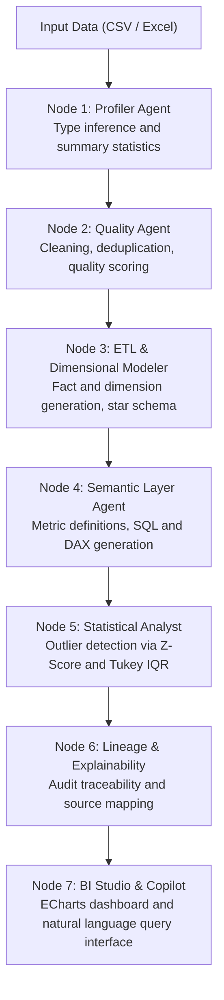

# Bi-Flow: Multi-Agent Business Intelligence and Analytics Platform

Bi-Flow is an automated data processing and business intelligence pipeline. It processes tabular datasets (CSV and Excel), performs data profiling and cleaning, constructs a dimensional star schema, generates business metrics with corresponding SQL and DAX queries, and exposes an interactive dashboard with conversational querying capabilities.

The pipeline is implemented using LangGraph for multi-agent coordination, FastAPI for service delivery, DuckDB for local SQL computation, and Apache ECharts for visualization.

---

## Overview

Traditional business intelligence workflows require multiple manual steps: data profiling, cleaning, dimensional modeling, metric definition, and dashboard design. Bi-Flow organizes these steps into a deterministic sequential multi-agent graph.

Raw input data is processed through seven stages:
1. Data profiling to identify column roles and data types.
2. Rule-based and statistical cleaning (deduplication, outlier handling, type casting).
3. Dimensional modeling into fact and dimension tables (Star Schema).
4. KPI generation with executable SQL (Apache Superset compatible) and DAX formulas (Power BI compatible).
5. Statistical anomaly detection using Z-Score and Tukey interquartile range (IQR).
6. Lineage tracking and audit record generation.
7. Dashboard rendering with an interactive interface and natural language querying.

All quantitative metrics are calculated directly via in-memory DuckDB queries against the cleaned data. Language models are utilized solely for schema interpretation, intent parsing, and natural language formatting.

---

## System Architecture



### Agent Roles

- **Profiler Agent**: Inspects table structure, missing value ratios, cardinality, and infers column semantic types (numeric, temporal, categorical, identifier).
- **Quality Agent**: Executes standardized data cleaning steps, flags anomalous rows, and calculates a data quality score before and after processing.
- **ETL and Dimensional Modeler**: Infers foreign-key relationships, creates a normalized star schema with one central fact table and associated dimension tables, and exports a relational schema diagram.
- **Semantic Layer Agent**: Extracts relevant business metrics, generates aggregation queries in SQL, and produces DAX formulas for Power BI compatibility.
- **Statistical Analyst Agent**: Runs univariate anomaly detection using standard statistical boundaries (|z| >= 2.5 and Tukey fences).
- **Lineage Agent**: Generates audit logs associating each KPI with its underlying SQL query, source columns, and execution proofs.
- **BI Studio Interface**: Presents the data through Apache ECharts and provides a natural language chat interface to filter, adjust, or generate visualizations.

---

## Interfaces and Endpoints

| Service | Address | Role |
|---|---|---|
| Web Application & BI Studio | `http://127.0.0.1:8000/studio` | Interactive dashboard, visual controls, and chat assistant |
| Main Web Interface | `http://127.0.0.1:8000` | Workflow monitoring and schema overview |
| Interactive API Documentation | `http://127.0.0.1:8000/docs` | OpenAPI / Swagger interface for backend endpoints |
| LangGraph Development Server | `http://127.0.0.1:2024` | Local LangGraph execution server |
| LangSmith Studio | Connected via Base URL `http://127.0.0.1:2024` | Live execution tracing and node state inspection |

---

## Prerequisites and Installation

### Prerequisites
- Python 3.10 or Python 3.11
- Operating System: Windows, Linux, or macOS

### Installation Steps

1. Clone the repository:
```bash
git clone https://github.com/dhia10/Bi-flow.git
cd Bi-flow
```

2. Install dependencies:
```bash
pip install -r requirements.txt
```

3. Configure environment variables (optional):
Create a `.env` file in the project root if you wish to enable external LLM fallbacks or LangSmith monitoring:
```env
# Optional: LLM provider for natural language copilot fallback
GEMINI_API_KEY=your_api_key_here

# Optional: LangSmith observability
LANGSMITH_TRACING=true
LANGSMITH_API_KEY=your_langsmith_key_here
LANGSMITH_PROJECT=bi-flow
```

---

## Execution

### Single-Command Startup (Windows)

To launch both the LangGraph development server and the FastAPI web application, run:
```bat
.\start_frontend.bat
```

This starts:
- LangGraph Dev server on port `2024` (background).
- FastAPI application and BI Studio on port `8000`.

Access the application in your browser:
- Main Interface: `http://127.0.0.1:8000`
- BI Studio: `http://127.0.0.1:8000/studio`

### Running Individual Services

To start only the FastAPI application:
```bash
python -m uvicorn src.api.routes:app --host 127.0.0.1 --port 8000
```

To run the standalone BI Studio server:
```bat
.\start_bistudio.bat
```

To run automated tests:
```bash
python -m pytest tests/ -v
```

---

## Conversational Interface Commands

The BI Studio interface accepts queries in English or French. It supports deterministic keyword matching as well as LLM semantic parsing when configured.

Example queries:
- Visualization requests:
  - `creer un pie brand par region`
  - `histogramme des ventes par categorie`
  - `top 10 customers by sales`
- Formatting requests:
  - `change la couleur des barres en vert`
  - `afficher les etiquettes a l'exterieur`
  - `ajoute un flou glassmorphism de 15px`
  - `axe Y max 5000 avec pas de 500`
- Filtering requests:
  - `filtre sur l'annee 2023`
  - `garde uniquement le segment Consumer`

When an LLM is not configured or offline, the interface falls back to deterministic rule-based parsing.

---

## Project Structure

```text
Bi-flow/
├── start_frontend.bat         # Windows startup script (FastAPI and LangGraph)
├── start_bistudio.bat         # Standalone BI Studio script
├── requirements.txt           # Python dependencies
├── .env.example               # Template for environment variables
│
├── Orchestrator/              # LangGraph pipeline definition
│   ├── orchestrator/          # Graph construction, state schema, and node routing
│   └── agents/                # Profiler, quality, ETL, and KPI generation logic
│
├── generator/                 # BI Studio frontend assets
│   ├── index.html             # Dashboard application layout
│   ├── dashboard.js           # ECharts chart rendering and state management
│   ├── agent.js               # Client-side intent parser and query handler
│   ├── libs/                  # Local static libraries (echarts.min.js)
│   └── kpis_catalog.json      # Generated KPI definitions and visualization metadata
│
├── src/                       # Backend services and utilities
│   ├── api/routes.py          # FastAPI route declarations and agent endpoints
│   ├── schemas/models.py      # Pydantic data models and validation contracts
│   ├── pipelines/             # Ingestion and query execution handlers
│   └── eval/                  # Metrics calculation and validation routines
│
├── artifacts/                 # Pipeline output directory (clean parquet, schema graphs)
└── tests/                     # Unit and integration test suite
```

---

## Technical Constraints and Verification

- Calculation Consistency: All KPI computations and analytical aggregations are executed deterministically using DuckDB SQL. The language models do not generate numerical estimates directly.
- Lineage: Every metric defined in `kpis_catalog.json` includes the underlying SQL query and source table reference.
- Fallback Mechanism: In environments without external network access or LLM credentials, the system operates using deterministic heuristics.

---

## License

This project is licensed under the Apache 2.0 License.
