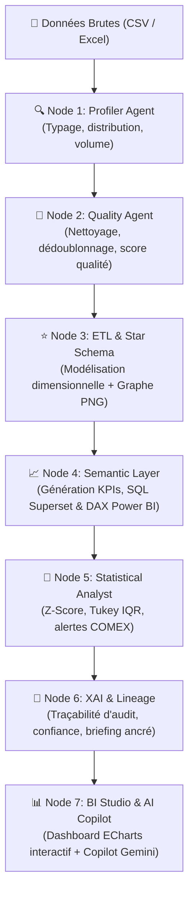

# 🚀 Bi-Flow — Autonomous Multi-Agent BI & AI Copilot Platform

> **Transform messy, raw business datasets into certified Star Schemas, executive KPIs, and interactive dashboards in minutes.**  
> Powered by **LangGraph**, **FastAPI**, **DuckDB**, **Apache ECharts**, and **Google Gemini**.

---

## 💡 What is Bi-Flow?

In most companies, turning a raw CSV or Excel file into actionable dashboards takes days or weeks:
1. Cleaning dirty rows, handling outliers, and fixing datatypes.
2. Designing a dimensional Star Schema (fact vs. dimension tables).
3. Writing correct SQL and DAX aggregations.
4. Detecting anomalies without statistical bias.
5. Building executive-ready visualizations.

**Bi-Flow automates this entire lifecycle using an autonomous multi-agent pipeline.**  
Drop your raw dataset (`.csv` or `.xlsx`) into the pipeline: 7 specialized agents analyze the data, enforce data quality, generate a relational Star Schema, compute business KPIs, detect statistical outliers, and render an interactive **Power BI / Apache Superset-style dashboard** with an integrated conversational AI Copilot.

---

## 🌟 Key Highlights

- **🧠 Multi-Agent Orchestration (LangGraph)** : 7 decoupled agents executing in sequence with state management and graph recovery.
- **🛡️ 100% Deterministic & Grounded (Zero Hallucinations)** : All metrics and figures are calculated strictly inside in-memory **DuckDB** engines. The LLMs reason, synthesize, and format — but never invent numbers.
- **⭐ Automated Star Schema Modeling** : Automatically identifies primary dimensions, measures, timestamps, and foreign relationships, generating fact tables, dimension tables, and visual schema relationship diagrams.
- **💬 Conversational BI Copilot** : Chat with your dashboard in plain French or English (*"créer un pie brand par region"*, *"top 5 clients en barres vertes"*, *"compare les devises à l'USD"*).
- **🎨 Executive Visual Studio** : Real-time interactive visualizations rendered via **Apache ECharts** (the open-source core of Apache Superset) with Power BI styling (glassmorphism, custom palettes, custom axis intervals, data labels).
- **🚨 Statistical Anomaly Mining** : Automatically runs Tukey's IQR fences and Z-score outlier detection to flag operational risks and margin leaks for COMEX executives.
- **🔭 Full Stack Observability** : Native integration with **LangSmith** and **LangGraph Studio Dev** (port `2024`) for live node inspection, latency tracing, and debug logs.

---

## 🏛️ Pipeline Architecture



### The 7 Specialized Agents

1. **`Profiler Agent`** : Scans raw records, detects inferred data types (temporal, numeric, categorical, identifiers), and builds the initial profiling report.
2. **`Quality Agent`** : Cleans null values, standardizes text fields, trims outliers, and computes an objective **Data Quality Score** before and after cleaning.
3. **`ETL & Star Schema Agent`** : Splits flat tables into a normalized dimensional model: `fact_transactions` linked to `dim_entities`, `dim_geography`, and `dim_calendar`, with automated relationship mapping.
4. **`Semantic Layer Agent`** : Synthesizes certified business KPIs (totals, averages, ratios) and writes the exact SQL queries (Superset-compatible) and DAX formulas (Power BI-compatible).
5. **`Statistical Analyst Agent`** : Flags critical variances ($|z| \ge 2.5$), negative gross margins, and unexpected trend shifts.
6. **`XAI & Lineage Agent`** : Enforces complete explainability — each KPI has an auditable trace linking back to source columns, execution proofs, and confidence scores.
7. **`BI Copilot & Visual Studio`** : Powers the interactive executive web UI, enabling users to modify visuals, switch chart types, and create new graphs using natural language prompts.

---

## 🖥️ Live Interfaces

| Service | URL | Description |
|---|---|---|
| **Web UI & BI Studio** | `http://127.0.0.1:8000/studio` | Interactive dashboard, KPI summary cards, format drawer, and AI Copilot |
| **Main Web Portal** | `http://127.0.0.1:8000` | Full workflow overview, star schema visual diagram, and run trigger |
| **Interactive API Docs** | `http://127.0.0.1:8000/docs` | OpenAPI / Swagger specification with all endpoints tested |
| **LangGraph Dev API** | `http://127.0.0.1:2024` | Local LangGraph Server for visual tracing |
| **LangSmith Studio** | [smith.langchain.com](https://smith.langchain.com/studio/?baseUrl=http://127.0.0.1:2024) | Live graph inspector for agent step-by-step executions |

---

## ⚡ Quickstart

### 1. Prerequisites
- **Python 3.10+** (Python 3.11 recommended)
- **Git**
- *(Optional)* [Google Gemini API Key](https://aistudio.google.com/) for enhanced natural language reasoning in the BI Copilot.

### 2. Installation

Clone the repository and install dependencies:
```bash
git clone https://github.com/dhia10/Bi-flow.git
cd Bi-flow
pip install -r requirements.txt
```

### 3. Environment Setup

Create a `.env` file in the root directory:
```env
# Optional: Enables automatic Gemini semantic reasoning in the Copilot
GEMINI_API_KEY=your_gemini_api_key_here

# Optional: LangSmith tracking
LANGSMITH_TRACING=true
LANGSMITH_API_KEY=your_langsmith_key_here
LANGSMITH_PROJECT=bi-flow
```

### 4. Launch in One Click (Windows)

Simply double-click or run:
```bat
.\start_frontend.bat
```

This single command:
- Sets up UTF-8 encoding.
- Starts **LangGraph Studio Dev Server** in the background on port `2024`.
- Starts the **FastAPI Web Application & BI Studio** on port `8000`.

Open your browser at **`http://127.0.0.1:8000`** or directly **`http://127.0.0.1:8000/studio`**.

---

## 💬 Interacting with the BI Copilot

The built-in chat copilot lets anyone build and style dashboards using plain language:

- **Create visual charts:**
  - *"Créer un pie brand par région"*
  - *"Histogramme des ventes par catégorie"*
  - *"Affiche le top 10 des clients par chiffre d'affaires"*
- **Format and customize (Power BI style):**
  - *"Change la couleur des barres en vert émeraude"*
  - *"Mets les étiquettes et pourcentages à l'extérieur du camembert"*
  - *"Applique un arrière-plan sombre avec flou glassmorphism 20px"*
  - *"Axe Y avec un pas de graduation de 500 et max de 3000"*
- **Filter and drill-down:**
  - *"Garde seulement les transactions de 2023"*
  - *"Filtre sur le secteur Technologie"*

---

## 📂 Project Structure

```text
Bi-flow/
├── start_frontend.bat         # Single-click launcher (FastAPI + LangGraph Studio)
├── start_bistudio.bat         # Standalone BI Studio launcher (port 8085)
├── requirements.txt           # Python project dependencies
├── .env                       # Local environment variables & API keys
│
├── Orchestrator/              # LangGraph multi-agent core
│   ├── orchestrator/          # Graph builder, nodes & state definitions
│   └── agents/                # Profiler, Quality, ETL, and KPI node logic
│
├── generator/                 # Executive BI Studio Frontend
│   ├── index.html             # BI Studio executive dashboard application
│   ├── dashboard.js           # ECharts visual registry, cards & layout engine
│   ├── agent.js               # Conversational Copilot (deterministic + Gemini)
│   ├── libs/                  # Offline libraries (echarts.min.js)
│   └── kpis_catalog.json      # Dynamic KPI definitions & auto-generated visuals
│
├── src/                       # Modular microservices & utility layer
│   ├── api/routes.py          # FastAPI application & BI Studio endpoints
│   ├── schemas/models.py      # Strict Pydantic V2 data contracts
│   ├── pipelines/             # Ingestion and query execution pipelines
│   └── eval/                  # RAGAS metrics & audit traceability
│
├── artifacts/                 # Generated files, clean parquets & star schema PNG
│   └── schema/                # Exported star schema relationship images
└── tests/                     # Unit and integration test suite
```

---

## 🛡️ Quality & XAI Guarantees

- **No Hallucinations** : LLMs are restricted to formatting and intent translation. Every computed value is queried directly through DuckDB SQL on the cleaned parquet dataset.
- **Audit Lineage** : The system preserves full lineage from the raw CSV input down to the exact SQL queries and DAX formulas shown on each visual.
- **Graceful Offline Fallback** : If no LLM API key is provided and Ollama is offline, the Copilot automatically runs in high-speed deterministic rule mode with zero latency.

---

## 🤝 Contributing

Contributions, feedback, and feature requests are welcome!  
Feel free to open an issue or submit a pull request on [GitHub](https://github.com/dhia10/Bi-flow).

---

## 📄 License

This project is licensed under the Apache 2.0 License.
